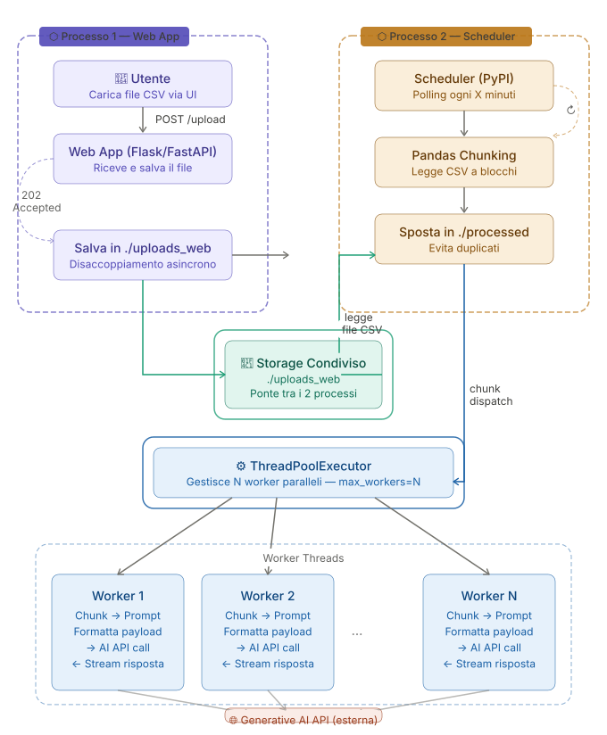

# ⚡ Hermes

> A lightweight, pluggable async batch processing scheduler for CSV files and Generative AI pipelines.

Hermes is an **independent background process** that watches a shared inbox folder, reads CSV files in memory-safe chunks, and dispatches work to a thread pool of AI workers — completely decoupled from any Web App upstream.

```
./uploads_web  ──►  Hermes  ──►  ThreadPoolExecutor  ──►  Generative AI API
  (inbox)           (loop)         (N workers)              (streaming)
```

---

## Table of Contents

- [Architecture](#architecture)
- [Project Structure](#project-structure)
- [Getting Started](#getting-started)
- [Configuration](#configuration)
- [Extending Hermes — Custom Workers](#extending-hermes--custom-workers)
- [Processing Loop](#processing-loop)
- [Logging](#logging)
- [GUI Control Room & Multi-Pool Management](#gui-control-room--multi-pool-management)
- [Roadmap](#roadmap)

---

## Architecture

Hermes is **Process 2** in a two-process system. It shares no memory, no imports, and no state with the Web App. The only communication channel between the two is the **shared file system** and the PostgreSQL database.



---

## Project Structure

```
Hermes/
├── pyproject.toml
├── requirements.txt
├── uv.lock
├── .env
├── .python-version
├── docker-compose.yml          # Docker Compose configuration
├── Dockerfile                  # Docker image build file
├── schema_progetto.sql         # PostgreSQL database schema
└── src/
    ├── __init__.py
    ├── main.py                 # Entry point
    ├── core/
    │   ├── __init__.py
    │   ├── config.py           # Environment variables
    │   ├── watcher.py          # Directory polling
    │   ├── mover.py            # Atomic rename
    │   └── reader.py           # Pandas chunking
    │
    ├── db/
    │   ├── __init__.py
    │   ├── db.py               # Engine and SessionMaker
    │   ├── models.py           # SQLAlchemy ORM classes (Tables)
    │   └── repository.py       # Queries (CRUD)
    ├── gui/                    # Control Room interface
    │   ├── app.py              # GUI entry point (FastAPI + PyWebView)
    │   ├── state.py            # Global shared state (processes, ws)
    │   ├── pages/
    │   │   └── index.html      # UI Dashboard (Tailwind CSS)
    │   ├── static/
    │   │   ├── css/style.css   # Custom styles (scrollbar, buttons)
    │   │   └── js/
    │   │       ├── app.js      # Frontend Javascript controller
    │   │       └── tailwind-config.js # Tailwind configuration
    │   └── routes/
    │       ├── __init__.py     # Router aggregator
    │       ├── control.py      # Engine and thread-pool control routes
    │       ├── dashboard.py    # Dashboard render route
    │       └── logs.py         # Log streaming (WS) and export (.txt)
    └── workers/
        ├── __init__.py
        ├── dispatcher.py       # ThreadPool management
        ├── worker_base.py      # Abstract baseWorker class
        └── ai_worker.py        # Model logic with Circuit Breaker
```

---

## Getting Started

### Prerequisites

- Docker and Docker Compose (Recommended)
- Python 3.10+ (If running locally without Docker)
- pip or uv

### Running with Docker (Recommended)

Hermes now supports full containerization with Docker and Docker Compose. This will spin up the Hermes engine/GUI and a PostgreSQL database automatically.

```bash
git clone https://github.com/your-org/hermes.git
cd hermes
docker compose up -d --build
```

This command will automatically:
- Start a `postgres:16-alpine` database and initialize it with `schema_progetto.sql`.
- Build and start the `hermes_app` container, mounting the local `uploads_web`, `processed`, and `failed` folders so you can easily drop CSV files from your host machine.
- Expose the Control Room dashboard on port `8000`.

You can access the Control Room dashboard at [http://localhost:8000](http://localhost:8000).

### Local Installation (Without Docker)

Using `uv` (Recommended):

```bash
git clone https://github.com/your-org/hermes.git
cd hermes
uv sync
```

Using standard `pip`:

```bash
git clone https://github.com/your-org/hermes.git
cd hermes
uv venv
source .venv/bin/activate       # Windows: .venv\Scripts\activate
uv pip install -r requirements.txt
```

### Setup

```bash
cp .env.example .env
# Edit .env with your values
```

Create the required folders (Hermes will also create them on startup if missing):

```bash
mkdir -p uploads_web processed failed
```

### Run

Using `uv` (Recommended):

```bash
uv run python -m src.main
```

Using python directly:

```bash
python -m src.main
```

### Run GUI Control Room Locally

To start the GUI Control Room (FastAPI + PyWebView):

Using `uv` (Recommended):
```bash
uv run python -m src.gui.app
```

Using python directly:
```bash
python -m src.gui.app
```

---

## Configuration

All settings are loaded from environment variables or a `.env` file in the project root.

| Variable               | Default         | Description                                       |
| ---------------------- | --------------- | ------------------------------------------------- |
| `HERMES_INBOX`         | `./uploads_web` | Folder watched for incoming CSV files             |
| `HERMES_ARCHIVE`       | `./processed`   | Destination for successfully processed files      |
| `HERMES_FAILED`        | `./failed`      | Destination for files that exceeded max retries   |
| `HERMES_POLL_INTERVAL` | `60`            | Seconds between each scan of the inbox            |
| `HERMES_CHUNK_SIZE`    | `1000`          | Number of rows per chunk (Pandas chunksize)       |
| `HERMES_MAX_WORKERS`   | `4`             | Max parallel threads in the ThreadPoolExecutor    |
| `HERMES_MAX_RETRIES`   | `3`             | Max worker retry attempts before moving to failed |

`.env.example`:

```env
HERMES_INBOX=./uploads_web
HERMES_ARCHIVE=./processed
HERMES_FAILED=./failed
HERMES_POLL_INTERVAL=60
HERMES_CHUNK_SIZE=1000
HERMES_MAX_WORKERS=4
HERMES_MAX_RETRIES=3
```

---

## Extending Hermes — Custom Workers

Hermes is designed to be **pluggable**. The processing logic lives in a single class that implements `WorkerBase`. You never touch the core pipeline.

### 1. Implement `WorkerBase`

```python
# my_project/my_worker.py
import pandas as pd
from hermes.worker_base import WorkerBase

class MyWorker(WorkerBase):
    def process(self, chunk: pd.DataFrame, metadata: dict) -> dict:
        """
        Args:
            chunk:    a pandas DataFrame slice of the original CSV
            metadata: dict with keys: filename, chunk_index, timestamp
        Returns:
            dict with at least: status ('ok' | 'error'), and any result data
        """
        # 1. Format your prompt from the chunk
        prompt = self._build_prompt(chunk)

        # 2. Call your AI API
        response = self._call_ai(prompt)

        # 3. Return structured result
        return {"status": "ok", "response": response, **metadata}

    def _build_prompt(self, chunk: pd.DataFrame) -> str:
        rows = chunk.to_csv(index=False)
        return f"Process the following data:\n\n{rows}"

    def _call_ai(self, prompt: str) -> str:
        # Your AI API client here
        ...
```

### 2. Register your worker in `.env`

```env
HERMES_WORKER_CLASS=my_project.my_worker.MyWorker
```

Hermes dynamically imports and instantiates the class at startup — no changes to core code required.

---

## Processing Loop

Each iteration of the Hermes loop follows these steps:

```
STEP 1 — Poll INBOX
  └─ No files found?  →  sleep(POLL_INTERVAL)  →  back to STEP 1
  └─ Files found?     →  pick oldest (FIFO)    →  STEP 2

STEP 2 — Atomic Move
  └─ os.rename(INBOX/file.csv, ARCHIVE/file.csv)
  └─ Rename failed?   →  log + skip            →  back to STEP 1

STEP 3 — Chunked Read
  └─ pd.read_csv(ARCHIVE/file.csv, chunksize=CHUNK_SIZE)
  └─ Parse error?     →  move to FAILED        →  back to STEP 1

STEP 4 — Dispatch
  └─ For each chunk:
       executor.submit(worker.process, chunk, metadata)  [non-blocking]
  └─ All chunks submitted                      →  back to STEP 1
```

On `SIGTERM` or `KeyboardInterrupt`, Hermes completes dispatch of the current file's chunks before exiting. No file is left in a partial state.

---

## Logging

Hermes uses Python's standard `logging` library with a structured format:

```
[HERMES] file=sales_jan.csv status=detected
[HERMES] file=sales_jan.csv status=moved_to_archive
[HERMES] file=sales_jan.csv chunk=0 status=dispatched rows=1000
[HERMES] file=sales_jan.csv chunk=1 status=dispatched rows=1000
[HERMES] file=sales_jan.csv chunk=2 status=dispatched rows=342
[HERMES] file=sales_jan.csv all_chunks=3 status=complete
[HERMES] file=sales_jan.csv chunk=1 status=worker_error retry=1/3
```

---

## GUI Control Room & Multi-Pool Management

Hermes offers a hybrid desktop dashboard to visually monitor and orchestrate the system:

- **Live Engine Status**: Start and stop the main polling loop.
- **Dynamic Thread Pool Management**:
  - Add new dedicated pools (e.g., `test_llm`, `production`) specifying the number of workers.
  - Hot-swap / Rename or resize workers without restarting the engine.
  - Delete no longer needed pools (queued tasks will be cancelled).
  - **Failsafe**: It is always mandatory to have at least one active pool if the engine is online. If a deleted/non-existent pool is requested, the system automatically redirects the task to the first available pool in the list (fallback).
- **Integrated Log Terminal**: Logs sent in real-time via WebSocket with timestamps.
- **Log Export**: Download a clean `.txt` file with header, with the ability to filter rows by start/end date and time.

---

## Roadmap

- [x] Core polling loop
- [x] Atomic file move
- [x] Pandas chunked reading
- [x] ThreadPoolExecutor dispatch
- [x] Pluggable `WorkerBase` interface
- [x] Retry with exponential backoff (`tenacity`)
- [x] Health check HTTP endpoint
- [x] GUI Dashboard (FastAPI + PyWebView)
- [x] Dynamic `MAX_WORKERS` & Multi-Pool reload without restart
- [x] Prometheus metrics exporter
- [x] PostgreSQL Database Integration
- [x] Docker + docker-compose setup

---

## License

Apache License 2.0
