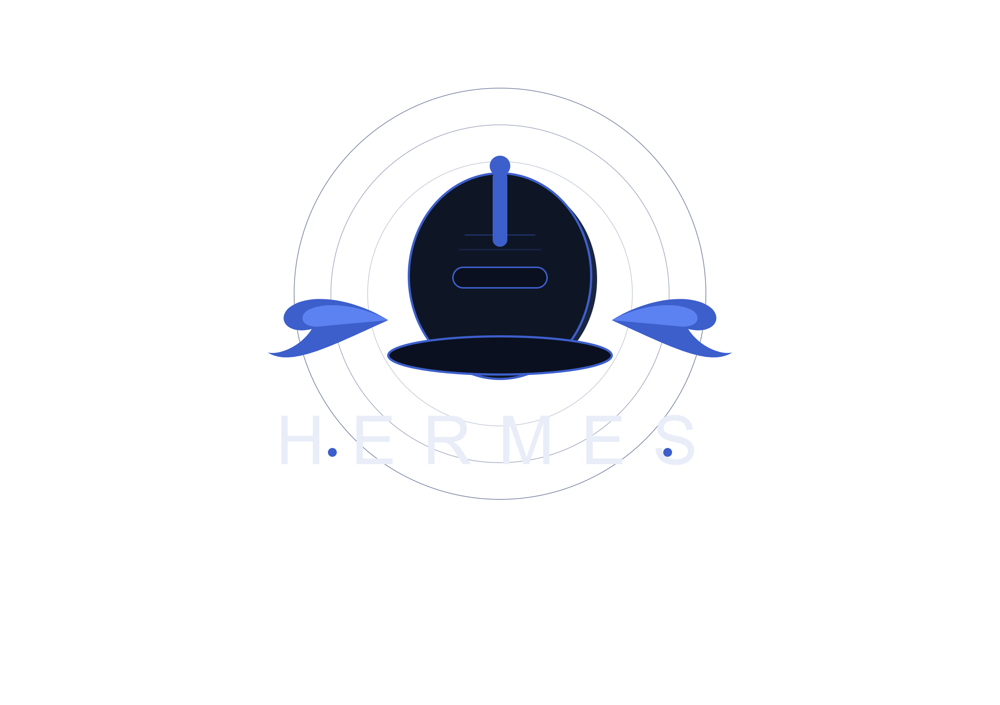
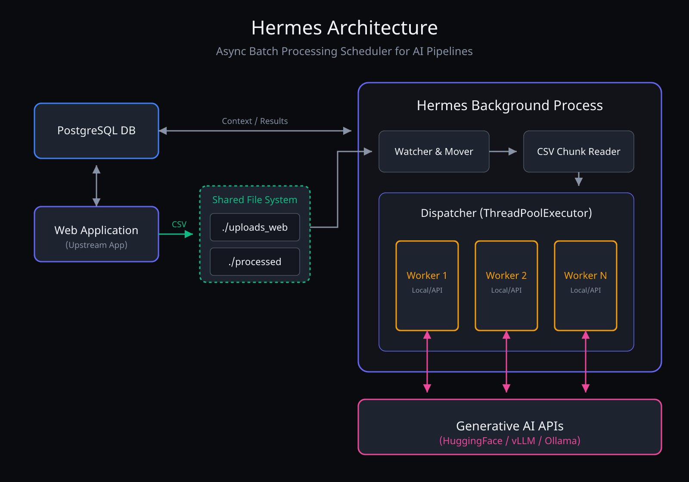

<p align="center">
  
</p>

<h1 align="center">⚡ Hermes</h1>

<p align="center">
  <em>A lightweight, pluggable async batch processing scheduler for CSV files and Generative AI pipelines.</em>
</p>

Hermes is an **independent background process** that watches a shared inbox folder, reads CSV files in memory-safe chunks, and dispatches work to a thread pool of AI workers — completely decoupled from any Web App upstream.

The `v0.1.0` baseline has been verified from a clean clone with PostgreSQL,
Alembic, Hugging Face Chat Completion and parameterized CSV prompts. The
current automated suite contains 245 tests with 74% overall coverage.

```
./uploads_web  ──►  Hermes  ──►  ThreadPoolExecutor  ──►  Generative AI API
  (inbox)           (loop)         (N workers)             (per-row calls)
```

---

## Table of Contents

- [Architecture](#architecture)
- [Project Structure](#project-structure)
- [Getting Started](#getting-started)
- [Configuration](#configuration)
- [Extending Hermes — Custom Workers](#extending-hermes--custom-workers)
- [Processing Loop](#processing-loop)
- [Logging](#logging)
- [GUI Control Room & Multi-Pool Management](#gui-control-room--multi-pool-management)
- [Testing](#testing)
- [Roadmap](#roadmap)

---

## Architecture

Hermes is **Process 2** in a two-process system. It shares no memory, no imports, and no state with the Web App. The only communication channel between the two is the **shared file system** and the PostgreSQL database.



---

## Project Structure

```
Hermes/
├── alembic.ini                    # Alembic entry configuration
├── docker-compose.yml             # Local app and PostgreSQL services
├── Dockerfile                     # Reproducible runtime image
├── pyproject.toml                 # Dependency and tool configuration
├── uv.lock                        # Reproducible uv resolution
├── requirements-runtime.txt       # Minimal Docker runtime dependencies
├── requirements.txt               # Export including optional extras
├── docs/images/                   # Images referenced by this README
├── scripts/
│   ├── create_admin.py            # Create a local Control Room account
│   ├── smoke_upload.py            # Manual CSV upload smoke client
│   ├── test_docker.sh             # Isolated tests on macOS/Linux
│   └── test_docker.ps1            # Isolated tests on Windows PowerShell
├── src/
│   ├── main.py                    # Processing-engine entry point
│   ├── api/                       # Engine health endpoint
│   ├── core/                      # Configuration and filesystem pipeline
│   ├── db/
│   │   ├── migrations/            # Canonical Alembic history
│   │   ├── db.py                  # Engine and session factory
│   │   ├── models.py              # SQLAlchemy models
│   │   ├── repository.py          # Database operations
│   │   └── status.py              # Canonical states and transitions
│   ├── gui/
│   │   ├── pages/                 # Control Room HTML
│   │   ├── routes/                # Control Room FastAPI routes
│   │   └── static/                # Control Room CSS, JS and images
│   └── workers/                   # Pools and LLM workers
└── test/                          # Automated pytest suite
```

The Control Room under `src/gui` is an internal technical interface. It is
separate from the user-facing React application maintained in
`hermes-webapp`.

### Dependency files

`pyproject.toml` is the source of truth for Python dependencies and optional
capabilities. `uv.lock` pins the complete resolution used by local development.
`requirements-runtime.txt` contains the smaller runtime installed in the Docker
image, while `requirements.txt` is generated with:

```bash
uv export --all-extras --no-hashes --output-file requirements.txt
```

When dependencies change, update `pyproject.toml`, regenerate `uv.lock` and the
export, and review `requirements-runtime.txt` if the Docker runtime is affected.

---

## Getting Started

### Prerequisites

- Docker Desktop or Docker Engine with Docker Compose (recommended)
- A Hugging Face token with `Inference Providers` permission for remote
  inference
- Python 3.12+ and `uv` only when running outside Docker

### 1. Clone and configure

The default branch contains the stable baseline. Contributors should create
feature branches from `develop`.

```bash
git clone https://github.com/Ilpupi00/Hermes.git
cd Hermes
cp .env.example .env
```

Before starting anything, edit `.env`, replace every `change-me` value and
generate a unique `SECRET_KEY`, for example with `openssl rand -hex 32`. Set
`HF_TOKEN` only when remote inference is required. Keep
`HF_INFERENCE_PROVIDER=featherless-ai` for the initial Qwen model.

Never commit `.env` or expose its values in screenshots, logs or issues.

### 2. Start the Docker baseline

```bash
mkdir -p uploads_web processed failed interrupted
docker compose up -d --build
docker compose ps
```

Docker Compose starts PostgreSQL, waits for it to become healthy, applies
`alembic upgrade head`, and exposes the Control Room at
[http://localhost:8000](http://localhost:8000). It does **not** start the
polling engine automatically.

Check application and database readiness:

```bash
curl http://localhost:8000/health
```

Expected response:

```json
{"status":"ok","database":"ok"}
```

### 3. Create the first administrator and start the engine

On a new database, create a local Control Room account:

```bash
docker exec -it hermes_app python scripts/create_admin.py <username>
```

The script requests the password twice without storing it in shell history.
Use at least eight characters. Log in, set the default pool to one worker for
the first test, and select **Avvia Motore**. Engine state is kept in memory, so
the engine must be started again after restarting the application container.

### 4. Run the first remote job

Upload `test/fixtures/phase3_reviews.csv`, select
`Qwen/Qwen2.5-0.5B-Instruct`, and use this initial configuration:

```text
temperature: 0.1
max tokens: 16
chunk size: 3
workers: 1
```

The prompt must reference the `review` CSV column, for example:

```text
Classifica il sentiment della seguente recensione:

{review}

Rispondi soltanto con Positivo, Negativo o Neutro.
```

The smoke-test gate is technical: three persisted results, a completed job and
the input CSV in `processed`. Qwen 0.5B is not a perfect classifier; quality
must be assessed separately with labelled data and calibrated prompts.

For a manual upload smoke test against an already running Control Room:

```bash
uv run python scripts/smoke_upload.py path/to/input.csv --model-id 1
```

The script does not embed credentials and uses the token configured locally.

### Parameterized prompts

Prompt placeholders use the corresponding CSV header name:

```text
Classifica il sentiment di {review} pubblicata il {date}.
```

At upload time Hermes validates the template syntax, required headers and all
values used by placeholders. A job is rejected before entering the inbox when
a required column is absent or a referenced value is empty. The initial
mapping is persisted per task as an identity mapping, for example
`review -> review`, so it can later evolve independently from the prompt.

Use doubled braces for literal JSON or other literal braces:

```text
Rispondi nel formato {{"sentiment": "Positivo|Negativo|Neutro"}}.
```

Only simple placeholder names are supported. Attribute access, indexes,
conversions and format specifications are rejected. Prompts without
placeholders retain the legacy behavior and receive the complete row data as
an appended dictionary.

### 5. Stop, inspect or reset Docker

Stop containers while preserving PostgreSQL data:

```bash
docker compose down
```

Inspect or manually apply schema migrations:

```bash
docker compose exec hermes alembic current
docker compose exec hermes alembic upgrade head
```

Delete containers and the PostgreSQL volume only for an intentionally clean
database reset:

```bash
docker compose down -v
```

### Local Installation (Without Docker)

Local execution still requires PostgreSQL configured in `.env`. `uv` creates
a project-local `.venv`; it does not install project dependencies globally.

Using `uv`:

```bash
git clone https://github.com/Ilpupi00/Hermes.git
cd Hermes
cp .env.example .env
uv sync --extra dev
mkdir -p uploads_web processed failed interrupted
docker compose up -d db
uv run alembic upgrade head
uv run python scripts/create_admin.py <username>
uv run uvicorn src.gui.app:app --host 127.0.0.1 --port 8000
```

Open the Control Room, log in and start the engine from the UI. Install only
the optional host capabilities that are needed:

```bash
uv sync --extra desktop     # native PyWebView window
uv sync --extra local-llm   # PyTorch/Transformers inference on the host
```

The optional desktop window is started with:

```bash
uv run python -m src.gui.app
```

On Apple Silicon, native `local-llm` inference must run on macOS to use MPS.
The Docker image intentionally excludes PyTorch and Transformers because its
Linux environment cannot use the Mac GPU. Docker still supports Hugging Face
remote inference and OpenAI-compatible servers such as Ollama.

Using standard `pip` in a project virtual environment:

```bash
python3 -m venv .venv
source .venv/bin/activate       # Windows: .venv\Scripts\activate
python -m pip install --upgrade pip
python -m pip install -e ".[dev]"
```

Runtime directories are intentionally ignored by Git:

| Directory | Current role |
| --- | --- |
| `uploads_web` | Shared inbox watched for new CSV files |
| `processed` | Current working/archive area; it will be split in a later phase |
| `failed` | Files whose processing failed |
| `interrupted` | Files deferred during shutdown or interruption |

Do not place source files or permanent documentation in these directories.

For advanced engine-only operation without the Control Room, run:

```bash
uv run python -m src.main
```

The standalone engine health endpoint uses port `8080` by default.

---

## Configuration

All settings are loaded from environment variables or a `.env` file in the project root.

| Variable                      | Default / requirement | Description                                        |
| ----------------------------- | --------------------- | -------------------------------------------------- |
| `DB_HOST`                     | `localhost`           | PostgreSQL host (`db` in Docker Compose)            |
| `DB_PORT`                     | `5432`                | PostgreSQL port                                     |
| `DB_NAME`                     | `postgres`            | PostgreSQL database                                 |
| `DB_USER`                     | `postgres`            | PostgreSQL user                                     |
| `DB_PASSWORD`                 | required in Docker    | PostgreSQL password                                 |
| `SECRET_KEY`                  | required              | Random key used to sign JWT                         |
| `ACCESS_TOKEN_EXPIRE_MINUTES` | `10080`               | JWT lifetime in minutes                             |
| `HF_TOKEN`                    | remote inference      | Token with the `Inference Providers` permission     |
| `HF_INFERENCE_PROVIDER`       | `featherless-ai`      | Provider Hugging Face per i modelli remoti iniziali |
| `HERMES_INBOX`                | `./uploads_web`       | Folder watched for incoming CSV files               |
| `HERMES_ARCHIVE`              | `./processed`         | Current working area and successful-file holding     |
| `HERMES_FAILED`               | `./failed`            | Destination for files that exceeded max retries     |
| `HERMES_INTERRUPTED`          | `./interrupted`       | Destination for interrupted files                   |
| `HERMES_POLL_INTERVAL`        | `60`                  | Seconds between each scan of the inbox              |
| `HERMES_CHUNK_SIZE`           | `1000`                | Number of rows per chunk (Pandas chunksize)         |
| `HERMES_MAX_WORKERS`          | `4`                   | Max parallel threads in the ThreadPoolExecutor      |
| `HERMES_MAX_RETRIES`          | `3`                   | Max retry attempts before moving to failed          |
| `HERMES_WORKER_CLASS`         | `src.workers.hybrid_worker.HybridWorker` | Worker import path              |
| `HERMES_AI_BASE_URL`          | local URL             | Endpoint for an OpenAI-compatible local server      |

The complete, sanitized template is tracked in `.env.example`. The legacy
variable `HUGGING_FACE` is temporarily accepted, but new configurations must
use `HF_TOKEN`. The initial Qwen model is served through Featherless AI, so
`HF_INFERENCE_PROVIDER=featherless-ai` selects it explicitly. `auto` remains
available for models whose provider can be selected automatically.

---

## Extending Hermes — Custom Workers

Hermes is designed to be **pluggable**. The processing logic lives in a single class that implements `WorkerBase`. You never touch the core pipeline.

### 1. Implement `WorkerBase`

```python
# my_project/my_worker.py
import pandas as pd
from src.workers.worker_base import WorkerBase

class MyWorker(WorkerBase):
    def process(self, chunk: pd.DataFrame, metadata: dict) -> dict:
        """
        Args:
            chunk:    a pandas DataFrame slice of the original CSV
            metadata: includes filename, chunk_index, cancel_event and model
        Returns:
            dict with at least: status ('ok' | 'error'), and any result data
        """
        # 1. Format your prompt from the chunk
        prompt = self._build_prompt(chunk)

        # 2. Call your AI API
        response = self._call_ai(prompt)

        # 3. Return structured result
        return {"status": "ok", "response": response, **metadata}

    def _build_prompt(self, chunk: pd.DataFrame) -> str:
        rows = chunk.to_csv(index=False)
        return f"Process the following data:\n\n{rows}"

    def _call_ai(self, prompt: str) -> str:
        # Your AI API client here
        ...
```

### 2. Register your worker in `.env`

```env
HERMES_WORKER_CLASS=my_project.my_worker.MyWorker
```

Hermes dynamically imports and instantiates the class at startup — no changes to core code required.

---

## Processing Loop

Each iteration of the Hermes loop follows these steps:

```
STEP 1 — Poll INBOX
  └─ No files found?  →  sleep(POLL_INTERVAL)  →  back to STEP 1
  └─ Files found?     →  pick oldest (FIFO)    →  STEP 2

STEP 2 — Claim File
  └─ shutil.move(INBOX/file.csv, PROCESSED/file.csv)
  └─ Move failed?     →  log + skip            →  back to STEP 1

STEP 3 — Chunked Read
  └─ pd.read_csv(PROCESSED/file.csv, chunksize=CHUNK_SIZE)
  └─ Parse error?     →  move to FAILED        →  back to STEP 1

STEP 4 — Dispatch
  └─ For each chunk:
       executor.submit(worker.process, chunk, metadata)  [non-blocking]
  └─ Wait for chunk results
  └─ Success       → keep file in PROCESSED + mark job completed
  └─ Row/fatal error → move file to FAILED + mark job failed
  └─ Shutdown interruption → move file to INTERRUPTED
```

`processed` currently acts as both the working area and successful-file
archive. On engine startup, recovery moves CSV files found there back to the
inbox. Until the planned `processing`/`processed` split is implemented, do not
use this behavior as an idempotent production recovery mechanism; preserve or
move completed outputs deliberately before restarting the engine. Interrupted
and cancellation behavior will be hardened in the filesystem-contract phase.

---

## Logging

Hermes uses Python's standard `logging` library with a structured format:

```
[HERMES] file=sales_jan.csv status=detected
[HERMES] file=sales_jan.csv status=moved_to_processed
[HERMES] file=sales_jan.csv chunk=0 status=dispatched rows=1000
[HERMES] file=sales_jan.csv chunk=1 status=dispatched rows=1000
[HERMES] file=sales_jan.csv chunk=2 status=dispatched rows=342
[HERMES] file=sales_jan.csv all_chunks=3 status=complete
[HERMES] file=sales_jan.csv chunk=1 status=worker_error retry=1/3
```

---

## GUI Control Room & Multi-Pool Management

Hermes offers a hybrid desktop dashboard to visually monitor and orchestrate the system:

- **Live Engine Status**: Start and stop the main polling loop.
- **Dynamic Thread Pool Management**:
  - Add new dedicated pools (e.g., `test_llm`, `production`) specifying the number of workers.
  - Hot-swap / Rename or resize workers without restarting the engine.
  - Delete no longer needed pools (queued tasks will be cancelled).
  - **Failsafe**: It is always mandatory to have at least one active pool if the engine is online. If a deleted/non-existent pool is requested, the system automatically redirects the task to the first available pool in the list (fallback).
- **Integrated Log Terminal**: Logs sent in real-time via WebSocket with timestamps.
- **Log Export**: Download a clean `.txt` file with header, with the ability to filter rows by start/end date and time.

---

## Testing

Hermes ships with automated tests for configuration, filesystem helpers,
prompt templating, repositories, API routes, pool dispatching and workers.
Tests use SQLite and mocked external services where isolation is appropriate.
Release clean-room checks separately verify Alembic and the end-to-end flow
against PostgreSQL.

### Test Stack

| Tool                 | Role                                     |
| -------------------- | ---------------------------------------- |
| `pytest`             | Test runner                              |
| `pytest-cov`         | Coverage reporting                       |
| `pytest-mock`        | Mock / patching utilities                |
| `SQLite (in-memory)` | Replaces PostgreSQL for DB tests         |
| `unittest.mock`      | Patches external I/O (HuggingFace, HTTP) |

### Test Structure

```
test/
├── api/                      # Standalone engine health endpoint
├── core/                     # Config, file pipeline and prompt templates
├── db/                       # Repository behavior and canonical statuses
├── gui/                      # Health, auth, upload, models, logs and control routes
├── workers/                  # Hybrid/legacy workers, dispatcher and base contracts
├── conftest.py               # Shared SQLite and FastAPI fixtures
└── test_main.py              # Scheduler and processing-loop behavior
```

### Running the Tests

Using `uv` (Recommended):

```bash
uv run pytest
```

Using python directly:

```bash
python -m pytest
```

Run a specific module:

```bash
uv run pytest test/workers/test_dispatcher.py -v
```

For beginners, the repository includes launchers that build an isolated image,
mount the source read-only and delete the test container automatically:

```bash
# macOS / Linux
./scripts/test_docker.sh
```

```powershell
# Windows PowerShell
.\scripts\test_docker.ps1
```

These scripts require only Docker. They do not install Python packages on the
host and do not require the application containers to be running.

The equivalent commands, useful for understanding or customizing the test
run, are:

```bash
docker build --tag hermes-test-runtime .
docker run --rm \
  --mount "type=bind,source=$PWD,target=/app,readonly" \
  --workdir /app \
  --entrypoint sh \
  hermes-test-runtime \
  -c 'uv pip install --system pytest pytest-cov && pytest -q -o addopts="" -p no:cacheprovider'
```

### Coverage

The normal `pytest` configuration prints terminal coverage and generates
`htmlcov/`. At release commit `e18a80b`, all 245 tests pass and total coverage
is 74%. Treat these numbers as a recorded baseline, not a permanent badge;
they must be updated when tests or source modules change.

---

## Roadmap

- [x] Core polling loop
- [x] Filesystem claim/move with explicit failure handling
- [x] Pandas chunked reading
- [x] ThreadPoolExecutor dispatch
- [x] Pluggable `WorkerBase` interface
- [x] Retry with exponential backoff (`tenacity`)
- [x] Health check HTTP endpoint
- [x] GUI Dashboard (FastAPI + PyWebView)
- [x] Dynamic `MAX_WORKERS` & Multi-Pool reload without restart
- [x] Prometheus metrics exporter
- [x] PostgreSQL integration with canonical Alembic schema
- [x] Docker + Docker Compose clean-room startup
- [x] Parameterized prompts persisted as CSV-column mappings
- [x] Hugging Face Chat Completion through Featherless AI
- [x] Automated suite (245 tests, 74% overall coverage at `e18a80b`)
- [ ] Split active `processing` storage from the successful `processed` archive
- [ ] Formalize the PostgreSQL/filesystem contract with `hermes-webapp`
- [ ] Benchmark and harden local inference on Apple Silicon

---

## License

Apache License 2.0
